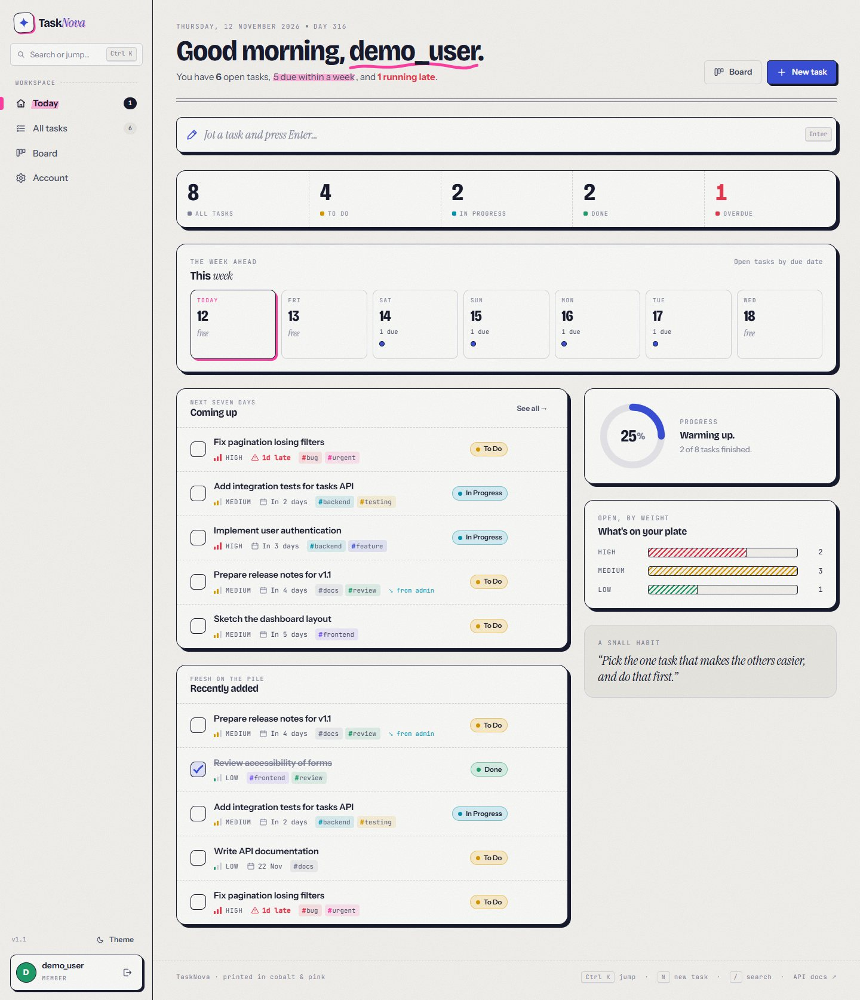
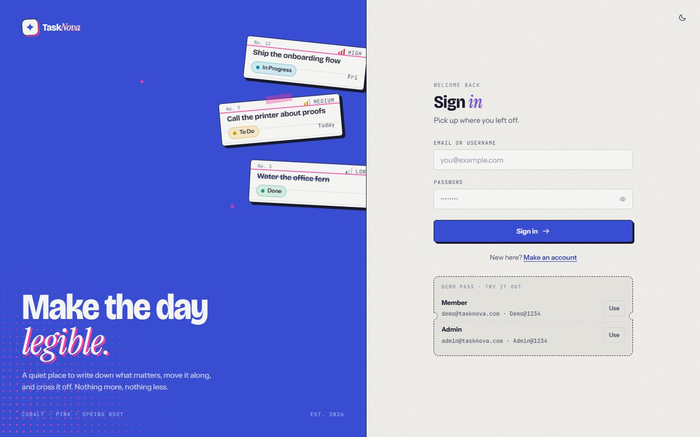
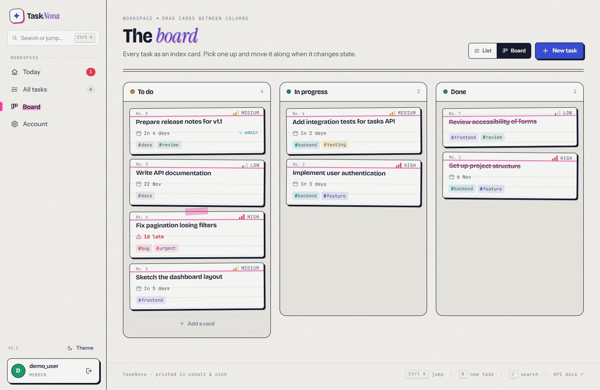
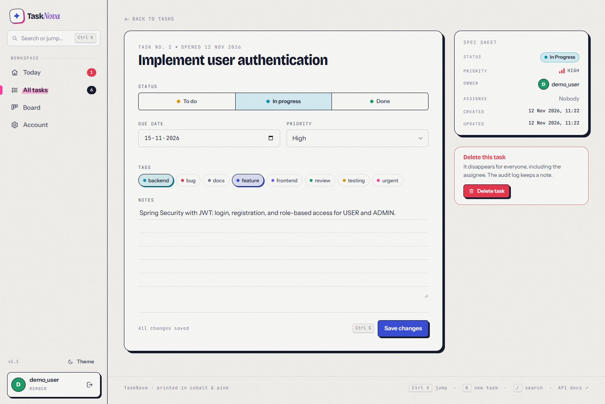
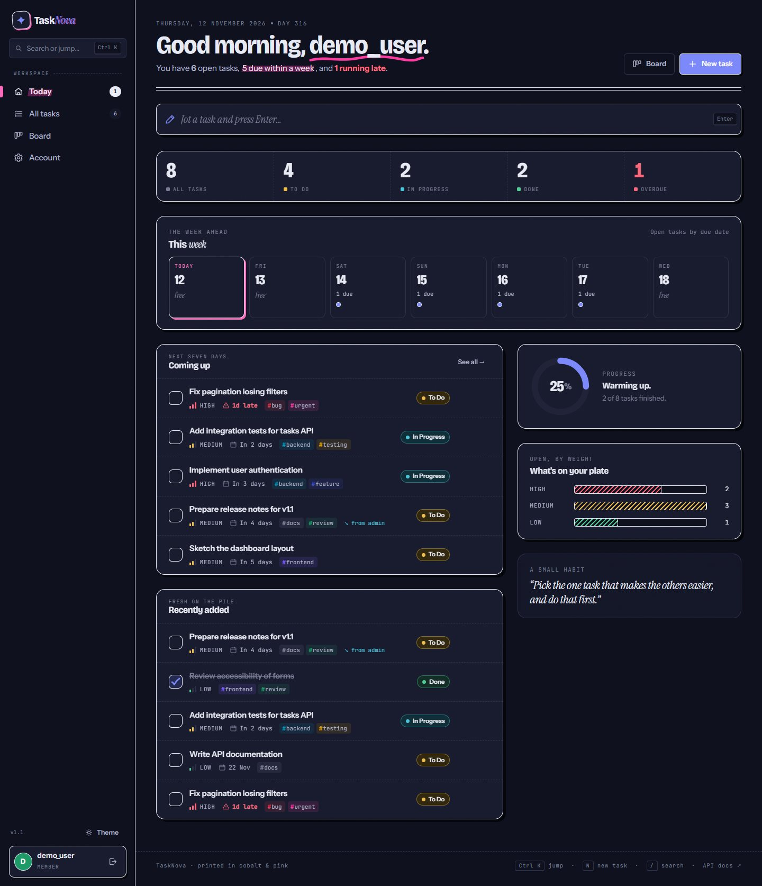
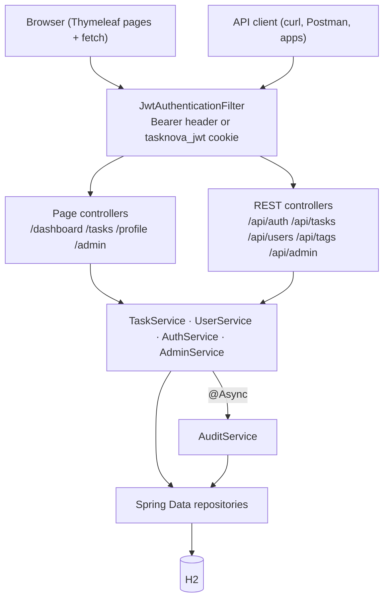

# TaskNova

[](https://openjdk.org/projects/jdk/17/)
[](https://spring.io/projects/spring-boot)
[](https://spring.io/projects/spring-security)
[](https://github.com/jwtk/jjwt)
[](https://www.thymeleaf.org/)
[](https://www.docker.com/)
[](./LICENSE)

A task manager built with **Spring Boot 3**, server-rendered with **Thymeleaf**, and backed by a
**JWT-secured REST API**. It has a personal workspace (list, kanban board, task editor), an admin desk
(people, every task, audit log), and a risograph-inspired interface with a dark mode.

<p align="center">
  
</p>

---

## Contents

- [Features](#features)
- [Quick start](#quick-start)
- [Screenshots](#screenshots)
- [How it's built](#how-its-built)
- [Security model](#security-model)
- [REST API](#rest-api)
- [Data model](#data-model)
- [Configuration](#configuration)
- [Docker](#docker)
- [Deploying to Render](#deploying-to-render)
- [Tests](#tests)
- [Project layout](#project-layout)
- [License](#license)

---

## Features

**Your workspace**
- **Today** dashboard: greeting, counts by status, a seven-day "this week" strip, what's coming up,
  recent tasks, a completion ring, and open work by priority. A quick-add line creates a task with one keystroke.
- **All tasks**: search titles and notes, filter by status, priority and tag, and tick tasks done in
  place (with a small confetti pop). Due dates read as "Today", "In 3 days" or "2d late".
- **Board**: three columns (To do, In progress, Done) of index cards. Drag a card to change its
  status, or add one straight into To do.
- **Task editor**: title, notes, due date, priority, tags and status, with unsaved-change tracking and
  <kbd>Ctrl</kbd>+<kbd>S</kbd> to save.
- **Account**: change your username or password.
- **Command palette**: <kbd>Ctrl</kbd>/<kbd>⌘</kbd>+<kbd>K</kbd> to search tasks or jump to any page.
- **Shortcuts**: <kbd>N</kbd> new task · <kbd>/</kbd> search · <kbd>Ctrl</kbd>+<kbd>S</kbd> save.
- **Sidebar counters** for open and overdue tasks.
- **Dark mode** that follows your OS and remembers your choice.

**Tasks**
- Status: `TODO` → `IN_PROGRESS` → `DONE`
- Priority: `LOW`, `MEDIUM`, `HIGH`
- Tags from a shared vocabulary: `bug`, `feature`, `urgent`, `backend`, `frontend`, `review`, `docs`, `testing`
- Optional due date; open tasks past their date are flagged **overdue**
- Admins can **assign** a task to someone else, and it then shows up in that person's workspace

**Admin desk** (`ROLE_ADMIN`)
- Overview: people and task counts, status distribution, and a live activity feed
- People: search, promote/demote, pause/restore accounts, and per-person task and activity pages
- Every task: search and status filter across all accounts
- Audit log: append-only record of sign-ins, registrations, task changes (including status moves),
  role changes and account pauses, filterable by who did it

---

## Quick start

**Prerequisites:** JDK 17+. Maven isn't needed; the wrapper downloads it.

```bash
git clone https://github.com/MalayShikharSoni/TaskNova.git
cd TaskNova

./mvnw spring-boot:run          # macOS / Linux
.\mvnw.cmd spring-boot:run      # Windows
```

Open <http://localhost:8080> and sign in with a seeded account. The login page has one-click
"Use" buttons for both:

| Role   | Email                | Username    | Password     |
| :----- | :------------------- | :---------- | :----------- |
| Admin  | `admin@tasknova.com` | `admin`     | `Admin@1234` |
| Member | `demo@tasknova.com`  | `demo_user` | `Demo@1234`  |

You can sign in with either the email or the username. New accounts can be created at `/auth/register`.

Other useful URLs:

| What              | URL |
| :---------------- | :-- |
| Swagger UI        | <http://localhost:8080/swagger-ui.html> |
| OpenAPI spec      | <http://localhost:8080/v3/api-docs> |
| H2 console        | <http://localhost:8080/h2-console> (JDBC URL `jdbc:h2:file:./data/tasknova`, user `sa`, no password) |
| Health            | <http://localhost:8080/actuator/health> |

Data is stored in `./data/tasknova.mv.db`, so it survives restarts. Delete that file to start fresh.

---

## Screenshots

| Sign in | Board |
| :-: | :-: |
|  |  |
| **Task editor** | **Dark mode** |
|  |  |

The interface is plain CSS and JavaScript, with no front-end framework or build step. The look
borrows from **risograph printing**: cool off-white paper, navy ink and two spot colours (cobalt
and fluorescent pink), with emphasised headline words printed slightly off-register. Type is
**Bricolage Grotesque** for headlines, **Instrument Serif** italic for emphasis, **Instrument Sans**
for text and **JetBrains Mono** for metadata. Hand-made touches include highlighter nav, scribble
underlines, hatched bar charts, halftone dots and an index-card board. Styles live in
[`static/css/main.css`](src/main/resources/static/css/main.css) as design tokens with a dark (deep
navy) theme override.

---

## How it's built

| Layer         | Technology | Notes |
| :------------ | :--------- | :---- |
| Framework     | Spring Boot 3.3.5, Java 17 | Spring MVC, Spring Data JPA, Validation, Actuator |
| Security      | Spring Security 6 + jjwt 0.12.6 | Form login → HttpOnly JWT cookie; Bearer tokens for API clients; BCrypt(12) |
| Persistence   | Hibernate 6 + H2 | File database locally, in-memory on Render's free tier |
| Views         | Thymeleaf 3.1 + Spring Security dialect | One layout, shared fragments for rows, pills and dialogs |
| Front end     | Vanilla CSS + JS | Native `<dialog>`, HTML5 drag-and-drop, `fetch` |
| API docs      | springdoc-openapi 2.6 | Swagger UI |
| Cross-cutting | Spring AOP | Service/controller timing logs; `@Auditable` annotation for declarative auditing |



Audit entries are written by `AuditService` on a background thread in their own transaction, so a
failed audit write never breaks the action that triggered it.

---

## Security model

- **Browser sessions**: `POST /auth/login-process` (form login) issues a signed JWT in the
  `tasknova_jwt` cookie. The cookie is `HttpOnly` (scripts can't read it), `SameSite=Lax`, and `Secure`
  when served over HTTPS, including behind a TLS-terminating proxy. Page scripts never handle the token.
- **API clients**: `POST /api/auth/login` returns the token in the response body; send it as
  `Authorization: Bearer <token>`.
- **Unauthenticated requests**: calls to `/api/**` get a plain `401`; page requests are redirected
  to the sign-in page.
- **CSRF**: the HTML forms (sign-out) carry a CSRF token. The JSON API relies on `SameSite=Lax` plus
  JSON bodies, and Bearer clients don't use cookies at all.
- **Sign-out** is `POST /auth/logout` only. It clears the cookie and the session.

**Access rules**

| Action on a task | Owner | Assignee | Admin |
| :--------------- | :---: | :------: | :---: |
| View / edit      | ✓ | ✓ | ✓ |
| Change status    | ✓ | ✓ | ✓ |
| Delete           | ✓ | — | ✓ |
| Assign           | — | — | ✓ |

Admins can't change their own role or pause their own account, which also guarantees at least one
admin always remains. Admin accounts must be demoted before they can be paused.

---

## REST API

Every endpoint except `/api/auth/**` needs authentication. Errors share one JSON shape:

```json
{ "timestamp": "…", "status": 400, "error": "Bad Request",
  "message": "Unknown tag: 'devops'.", "path": "/api/tasks",
  "fieldErrors": { "title": "Task title is required" } }
```

(`fieldErrors` only appears for bean-validation failures.)

### Auth: `/api/auth`

| Method | Endpoint             | Body | Notes |
| :----- | :------------------- | :--- | :---- |
| `POST` | `/api/auth/register` | `{ username, email, password }` | `201`. Username 3–50 chars `[A-Za-z0-9_]`; password 8+ with upper, lower and digit. Email and username are unique case-insensitively. |
| `POST` | `/api/auth/login`    | `{ email, password }` | `email` accepts an email **or** a username. Also sets the session cookie. |

```bash
curl -s -X POST http://localhost:8080/api/auth/login \
  -H "Content-Type: application/json" \
  -d '{"email": "demo_user", "password": "Demo@1234"}'
```

```json
{
  "token": "eyJhbGciOiJIUzI1NiJ9…",
  "type": "Bearer",
  "userId": 2,
  "username": "demo_user",
  "email": "demo@tasknova.com",
  "role": "ROLE_USER",
  "expiresAt": 1763050000000
}
```

### Tasks: `/api/tasks`

You see tasks you own **and** tasks assigned to you.

| Method   | Endpoint            | Notes |
| :------- | :------------------ | :---- |
| `GET`    | `/api/tasks`        | Paged (10 per page, newest first). Query: `status`, `priority`, `search` (title/notes), `tag`, `page`. |
| `GET`    | `/api/tasks/recent` | Five most recent. |
| `GET`    | `/api/tasks/{id}`   | |
| `POST`   | `/api/tasks`        | `{ title, description?, dueDate?, priority?, tagNames?, assigneeId? }` → `201`. `dueDate` can't be in the past; `assigneeId` is admin-only. |
| `PUT`    | `/api/tasks/{id}`   | **Replace**: `title` required; `description`, `dueDate` and `tagNames` are set exactly as sent (`null` clears them); admins also replace `assigneeId` (`null` unassigns). Omitted `priority`/`status` keep their value. |
| `PATCH`  | `/api/tasks/{id}`   | **Partial**: only fields you send change, e.g. `{ "status": "DONE" }`. |
| `DELETE` | `/api/tasks/{id}`   | Owner or admin. |

`tagNames` must use existing tags (case-insensitive; a leading `#` is fine). Unknown names return `400`.

Responses include both `tags` (names) and `tagDetails` (`{ id, name, color }`), plus `statusLabel`,
`overdue`, `dueInDays` (negative when past), `ownerId`/`ownerUsername`, `assigneeId`/`assigneeUsername`, `createdAt` and `updatedAt`.

### Account and tags

| Method | Endpoint        | Notes |
| :----- | :-------------- | :---- |
| `GET`  | `/api/users/me` | Your profile. |
| `PUT`  | `/api/users/me` | `{ username? }` and/or `{ currentPassword, newPassword }`. |
| `GET`  | `/api/tags`     | The tag vocabulary with colours. |

### Admin: `/api/admin` (`ROLE_ADMIN`)

| Method  | Endpoint                             | Notes |
| :------ | :----------------------------------- | :---- |
| `GET`   | `/api/admin/dashboard`               | Counts, completion %, and the latest audit entries. |
| `GET`   | `/api/admin/users`                   | Paged; `search` matches username or email. |
| `GET`   | `/api/admin/users/{id}`              | |
| `GET`   | `/api/admin/users/assignable`        | Active users, for assignment pickers. |
| `PATCH` | `/api/admin/users/{id}/toggle-active`| Pause or restore. Not allowed on yourself or on admins. |
| `PATCH` | `/api/admin/users/{id}/role`         | `{ "role": "ADMIN" \| "USER" }`. Not allowed on yourself. |
| `GET`   | `/api/admin/tasks`                   | Every task; `search`, `status`, `page`. |
| `GET`   | `/api/admin/audit-logs`              | Newest first; `actor` does a partial, case-insensitive match. |

Swagger UI documents the same endpoints interactively. Sign in with `POST /api/auth/login`, then
paste the `token` into **Authorize**.

---

## Data model

| Table        | Holds |
| :----------- | :---- |
| `users`      | username, email (both unique), BCrypt hash, role (`USER`/`ADMIN`), active flag, created time |
| `tasks`      | title, description, due date, priority, status, `owner_id`, optional `assignee_id`, created/updated times |
| `tags`       | unique name and hex colour |
| `task_tags`  | task ↔ tag join table |
| `audit_logs` | actor (email), action, target type and id, details, timestamp |

The schema is generated by Hibernate (`ddl-auto=update`). On first start, `DataSeeder` adds the two
accounts, the tags and a handful of sample tasks (one of them assigned to the demo user by the admin),
and it never duplicates them on later starts.

---

## Configuration

Everything can be set with environment variables:

| Variable | Default | Purpose |
| :------- | :------ | :------ |
| `PORT` | `8080` | HTTP port |
| `SPRING_PROFILES_ACTIVE` | *(none)* | `prod` turns off the H2 console, caches templates, limits actuator, and **requires** `JWT_SECRET` |
| `SPRING_DATASOURCE_URL` | `jdbc:h2:file:./data/tasknova;…` | JDBC URL |
| `SPRING_DATASOURCE_USERNAME` / `_PASSWORD` | `sa` / *(empty)* | Database credentials |
| `H2_DB_PATH` | `./data/tasknova` | File location used by the `prod` profile |
| `SPRING_JPA_HIBERNATE_DDL_AUTO` | `update` | Schema strategy |
| `JWT_SECRET` | dev-only built-in key | HS256 key: Base64, or any plain string of 32+ bytes |
| `JWT_EXPIRATION_MS` | `86400000` (24h) | Token and cookie lifetime |
| `ADMIN_PASSWORD` | `Admin@1234` | Password for the seeded `admin` account (first start only) |
| `DEMO_PASSWORD` | `Demo@1234` | Password for the seeded `demo_user` account (first start only) |
| `SHOW_DEMO_HINT` | `true` | Show the demo-credentials card on the sign-in page. The admin row is hidden automatically once `ADMIN_PASSWORD` is changed. |
| `SPRING_H2_CONSOLE_ENABLED` | `true` (`false` in `prod`) | `/h2-console` |
| `LOGGING_LEVEL_COM_TASKNOVA` | `DEBUG` (`INFO` in `prod`) | App log level |

> For anything other than a public demo, set `JWT_SECRET` and `ADMIN_PASSWORD`, and consider
> `SHOW_DEMO_HINT=false`.

---

## Docker

The multi-stage [`Dockerfile`](./Dockerfile) builds with Maven on Temurin 17, then runs the jar on a
slim Temurin 17 JRE as a non-root user, with a container health check.

```bash
docker build -t tasknova .
docker run -d -p 8080:8080 \
  -e SPRING_PROFILES_ACTIVE=prod \
  -e JWT_SECRET="$(openssl rand -base64 48)" \
  -e ADMIN_PASSWORD='choose-something-strong' \
  -v tasknova-data:/app/data -e H2_DB_PATH=/app/data/tasknova \
  --name tasknova tasknova
```

---

## Deploying to Render

[`render.yaml`](./render.yaml) is a Render Blueprint. Fork the repo, then in Render choose
**New → Blueprint** and pick the fork. It deploys the Docker image on the free plan with the `prod`
profile, a generated `JWT_SECRET`, and health checks on `/actuator/health`.

The free plan has no persistent disk, so the blueprint runs H2 **in memory**: data resets on every
restart, which suits a public demo. For real use, add a disk, set `H2_DB_PATH` to a path on it, remove
the in-memory datasource override, and set `ADMIN_PASSWORD` (see the comments in the blueprint).

---

## Tests

```bash
./mvnw test
```

The 31 integration tests (MockMvc against an in-memory database) cover sign-in by email and by
username, cookie flags, rendering of every page, the 401/404/400 error paths, assignment visibility
and permissions, PUT/PATCH semantics, relative due days, tag validation, admin self-protection,
case-insensitive registration, and profile updates.

---

## Project layout

```text
TaskNova/
├── Dockerfile · render.yaml · pom.xml · mvnw · mvnw.cmd
├── docs/screenshots/
└── src/
    ├── main/java/com/tasknova/
    │   ├── aop/            Logging aspect, @Auditable + AuditAspect
    │   ├── config/         Security, JWT settings, JPA auditing, shared model attributes
    │   ├── controller/     Page controllers (Home, Dashboard, Task, Profile, Auth, Admin)
    │   │   └── api/        REST controllers (Auth, Task, User, Tag, Admin)
    │   ├── dto/            Request/response objects
    │   ├── entity/         User, Task, Tag, AuditLog (+ enums)
    │   ├── exception/      GlobalExceptionHandler and custom exceptions
    │   ├── repository/     Spring Data repositories
    │   ├── security/       JWT filter, token provider, cookie service, UserDetailsService
    │   ├── seed/           DataSeeder
    │   └── service/        Task, User, Auth, Admin, Audit services
    ├── main/resources/
    │   ├── static/         css/main.css · js/*.js · assets/ (icon sprite, favicon)
    │   └── templates/      layout/ · fragments/ · user/ · admin/ · auth/ · error/
    └── test/               Integration tests
```

---

## License

[MIT](./LICENSE). Contributions and issues are welcome on the
[issues page](https://github.com/MalayShikharSoni/TaskNova/issues).

<p align="center">
  Crafted by <a href="https://github.com/MalayShikharSoni">Malay Shikhar Soni</a>
</p>
